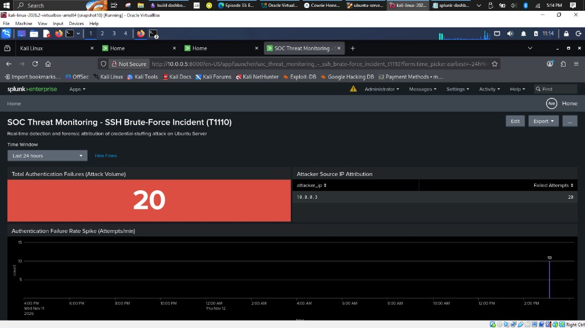
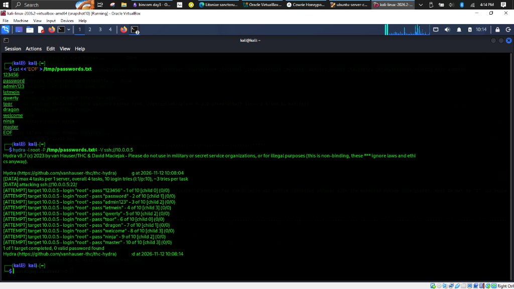
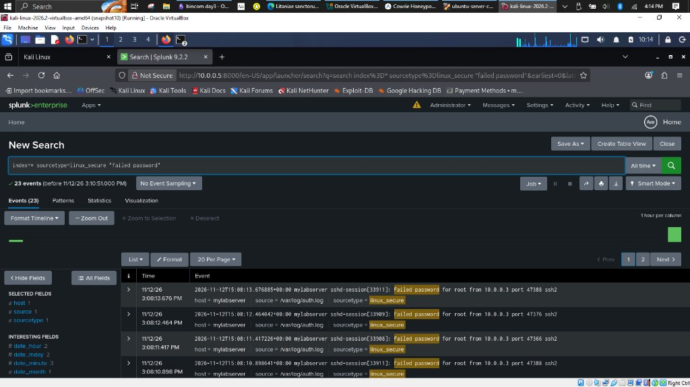
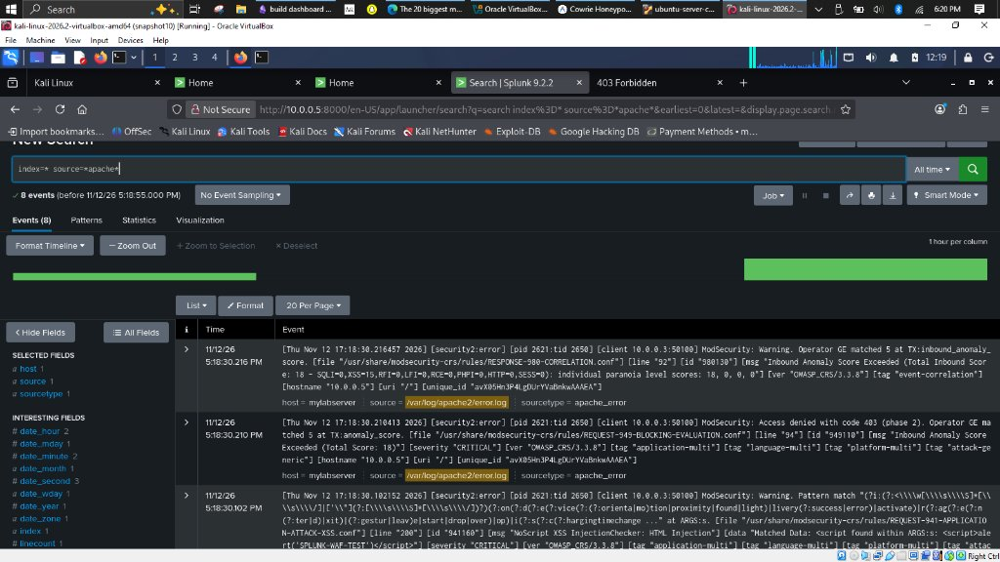

# 🛡️ Enterprise SOC Threat Monitoring, SIEM Log Analysis & Adversarial AI Defense
### Hands-on Cybersecurity Lab: Splunk Enterprise SIEM Deployment, Credential-Stuffing Forensic Attribution, and NIST AI Risk Assessment

<p align="center">
  
  
  
  
  
  
</p>

---

## 📌 Project Overview & Metadata

* **Author / Lead Security Analyst:** Qazeem Samsudeen Temitope ([@qazeemsamshudeen-web](https://github.com/qazeemsamshudeen-web) | *BlaqqSec*)
* **Specialization:** Security Operations Center (SOC), Threat Intelligence & Application Defense
* **SIEM Platform:** Splunk Enterprise v9.2.2 (Linux 64-bit .deb)
* **Target Defense Host:** Ubuntu Server 22.04 LTS (`10.0.0.5`)
* **Attacker Simulation Host:** Kali Linux 2026.2 VM (`10.0.0.3`)
* **Network Topology:** VirtualBox Isolated Subnet (`10.0.0.0/24`)

In an enterprise security operations environment, rapid detection and forensic attribution of credential-based attacks are paramount. This repository documents an end-to-end SOC defensive pipeline:
1. **LVM Storage Expansion & Architecture Preparation:** Extending Ubuntu root storage by +11.5 GB to host Splunk Enterprise.
2. **Telemetry Ingestion Pipeline:** Monitoring live Linux authentication logs (`/var/log/auth.log` -> `linux_secure`) and Apache ModSecurity WAF logs (`/var/log/apache2/error.log` -> `apache_error`).
3. **Automated Attack Simulation:** Executing multi-threaded SSH dictionary attacks using **THC-Hydra v9.7** from Kali Linux.
4. **Real-Time SOC Dashboard Engineering:** Building a dark-mode classic Splunk dashboard with Single-Value KPIs, attacker IP attribution tables, and velocity spike charts.
5. **Formal Incident Analysis & Host Hardening:** Investigating the attack timeline, mapping to **MITRE ATT&CK T1110.001**, and deploying **Fail2ban IPS** and SSH cryptographic key enforcement.
6. **AI Risk Assessment & Tool Justification:** Evaluating **Microsoft Counterfit** against **MITRE ATLAS** and the **NIST AI Risk Management Framework (AI RMF 1.0)**.

---

## 🏗️ Architectural Topology

```text
+-------------------------------------------------------------------------------------------------+
|                                    SOC LAB TELEMETRY TOPOLOGY                                   |
+-------------------------------------------------------------------------------------------------+

     [ ATTACKER MACHINE ]                                      [ TARGET DEFENSE SERVER ]
         Kali Linux VM                                             Ubuntu Server 22.04
         IP: 10.0.0.3                                                  IP: 10.0.0.5
    +--------------------+                                      +------------------------+
    |  THC-Hydra v9.7    |                                      | OpenSSH Server (22)    |
    |  Wordlist Attack   +=======[ Multi-Threaded SSH ]========>| Apache ModSecurity (80)|
    +--------------------+                                      +-----------+------------+
                                                                            |
                                                                   Live Telemetry Logs:
                                                                   - /var/log/auth.log
                                                                   - /var/log/apache2/*.log
                                                                            |
                                                                            v
                                                                +------------------------+
                                                                | Splunk Enterprise SIEM |
                                                                | Daemon & Index Engine  |
                                                                | Web UI: Port 8000      |
                                                                +-----------+------------+
                                                                            |
                                                                            v
                                                                +------------------------+
                                                                | Real-Time SOC Dashboard|
                                                                | - Single Value KPI (20)|
                                                                | - Attacker IP Table    |
                                                                | - 1-Min Spike Chart    |
                                                                +------------------------+
```

---

## 🎯 Primary Deliverables

### Deliverable 1: Real-Time Dark-Mode SOC Threat Monitoring Dashboard
* **Dashboard XML Definition:** [`soc_threat_monitoring_dashboard.xml`](soc_threat_monitoring_dashboard.xml)
* **Visual Verification:**
<p align="center">
  
  <br>
  <em>Figure 1.1: Live Splunk Dark-Mode SOC Dashboard showing 20 authentication failures, attacker attribution (10.0.0.3), and velocity burst charting.</em>
</p>

### Deliverable 2: Security Incident Analysis & Forensic Investigation Report
* **Full Report:** [`INCIDENT_ANALYSIS_REPORT.md`](INCIDENT_ANALYSIS_REPORT.md)
* **Summary:** Deep forensic timeline reconstructing 20 credential-stuffing attempts targeting the `root` account via THC-Hydra, mapping to MITRE ATT&CK T1110.001, root-cause assessment, and automated containment via Fail2ban.

### Deliverable 3: AI Security Risk Assessment & Tool Justification Report
* **Full Report:** [`AI_RISK_ASSESSMENT_REPORT.md`](AI_RISK_ASSESSMENT_REPORT.md)
* **Summary:** Evaluation of **Microsoft Counterfit** for automated adversarial testing of machine learning models, mapping threats to **MITRE ATLAS** (`AML.T0015` Evasion, `AML.T0018` Poisoning, `AML.T0040` Inversion), and governance alignment with **NIST AI RMF 1.0**.

### Operational Runbook & Reproduction Guide
* **PDF Edition (Publication Grade):** [`DAY4_RUNBOOK.pdf`](DAY4_RUNBOOK.pdf)
* **Markdown Edition:** [`DAY4_RUNBOOK.md`](DAY4_RUNBOOK.md)
* **HTML Interactive Guide:** [`DAY4_RUNBOOK.html`](DAY4_RUNBOOK.html)

---

## 🔍 Forensic Investigation & Telemetry Evidence

| Figure | Description | Evidence Screenshot |
| :---: | :--- | :---: |
| **2.1** | **THC-Hydra Attack Execution:** Multi-threaded dictionary attack against SSH (`10.0.0.5:22`) generating repeated failures. |  |
| **2.2** | **Splunk Telemetry Verification:** Raw `linux_secure` log ingestion verifying timestamped `Failed password for root` events. |  |
| **2.3** | **Correlated Perimeter WAF Blocks:** Apache ModSecurity Rule 941160 intercepting concurrent XSS probes with HTTP 403. |  |

---

## 💻 Splunk Search Processing Language (SPL) Queries

### 1. Attack Volume Counter (Single-Value KPI)
```spl
index=* sourcetype=linux_secure "Failed password" 
| stats count
```

### 2. Attacker Source IP Attribution & Sorting
```spl
index=* sourcetype=linux_secure "Failed password" 
| rex "from (?<attacker_ip>\d+\.\d+\.\d+\.\d+)" 
| stats count as "Failed Attempts" by attacker_ip 
| sort - "Failed Attempts"
```

### 3. Attack Rate Spike Frequency (Velocity Chart)
```spl
index=* sourcetype=linux_secure "Failed password" 
| timechart span=1m count
```

### 4. ModSecurity WAF Correlation
```spl
index=* source=*apache* "Access denied with code 403"
```

---

## 🛡️ Host Hardening & Remediation Steps

### 1. Automated Intrusion Prevention (Fail2ban)
```bash
sudo apt-get install -y fail2ban
sudo cp /etc/fail2ban/jail.conf /etc/fail2ban/jail.local
# Set sshd jail: maxretry = 5, bantime = 3600
sudo systemctl restart fail2ban
```

### 2. OpenSSH Server Hardening
```bash
# Prohibit root logins and eliminate password-based authentication
sudo sed -i 's/PermitRootLogin yes/PermitRootLogin no/' /etc/ssh/sshd_config
sudo sed -i 's/PasswordAuthentication yes/PasswordAuthentication no/' /etc/ssh/sshd_config
sudo systemctl restart ssh
```

---

## 👤 Author & Contact

* **Lead Analyst:** Qazeem Samsudeen Temitope (*BlaqqSec*)
* **GitHub:** [@qazeemsamshudeen-web](https://github.com/qazeemsamshudeen-web)
* **LinkedIn:** [Qazeem Samsudeen](https://www.linkedin.com)
* **Email:** qazeemsamshudeen@gmail.com
